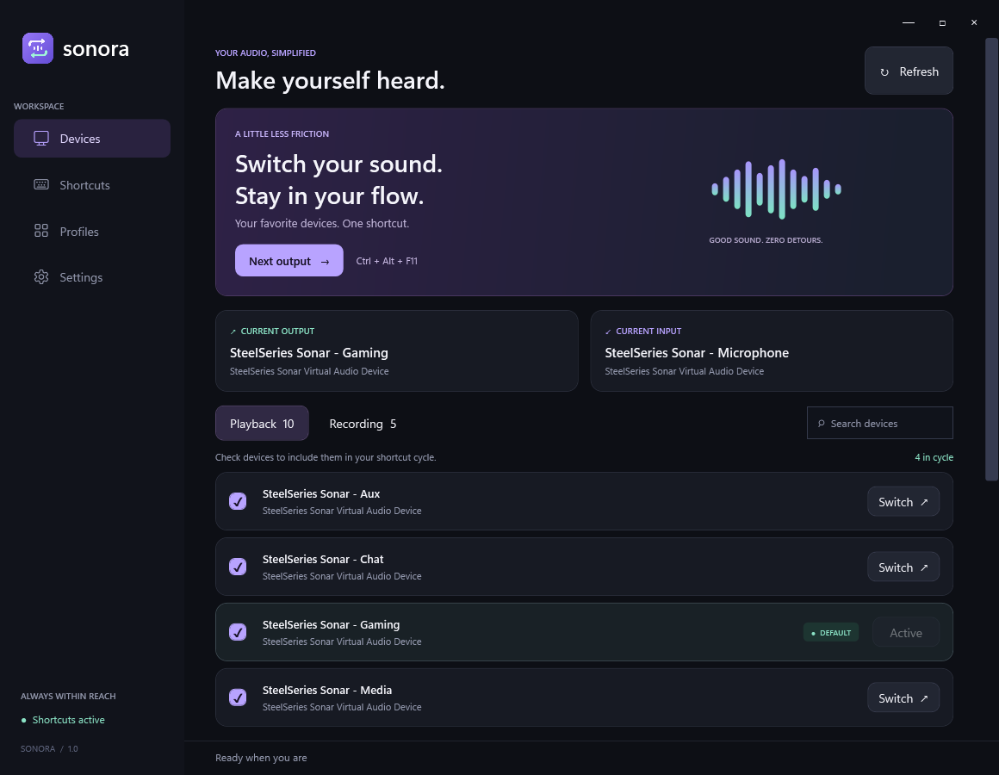
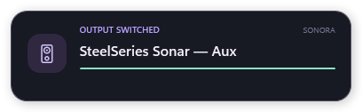

<p align="center"></p>
<h1 align="center">Sonora</h1>
<p align="center">Your sound. One shortcut away.</p>

Sonora is a native Windows desktop app for switching playback and recording devices with custom global shortcuts. Pick the devices in your cycle, save output/microphone pairs as profiles, and keep everything within reach from the system tray.





## Download

Download **Sonora.exe** from the [latest release](https://github.com/youval1234/Sonora/releases/latest). It is a portable, self-contained Windows x64 app: no installer, administrator access, or separate .NET installation required. Windows 10 (1809+) or Windows 11 is required.

The executable is currently unsigned. Smart App Control can block it; there is no per-app exception. Automated signing and release publication are prepared, but an approved signing provider is still required. A GitHub download or checksum alone does not establish a trusted publisher. See the [Code signing policy](CODE_SIGNING.md). Release assets include a SHA-256 checksum. Keep the executable in a permanent folder before enabling “Start with Windows.”

## What it does

- Lists real connected playback and recording endpoints, including virtual devices such as SteelSeries Sonar.
- Cycles only through your selected, currently connected devices. Disconnected choices are remembered for reconnection.
- Records separate, customizable system-wide input and output shortcuts. Conflicts are reported without silently replacing your previous shortcut.
- Switches console and multimedia defaults, with optional communications switching for calls.
- Saves profiles with an output, an input, and an optional dedicated global shortcut.
- Offers direct device selection and profile activation from the tray.
- Refreshes changes to devices and defaults automatically, with an explicit Refresh button too.
- Supports optional notifications, startup with Windows, and closing to the tray.
- Plays a warm, soft confirmation pluck after successful playback, recording and profile hotkeys, with distinct input and output cues.
- Shows a compact popup near the bottom of your active display. Rapid switches replace the current device immediately and restart its timeout, without queuing Windows notifications or taking focus.
- Exports readable Notepad `.txt` backups, imports saved settings, and migrates device choices and shortcuts directly from SoundSwitch.
- Keeps preferences locally. No accounts, network requests, advertising, or telemetry in the app.

## First run

1. Open **Sonora.exe**. Your current default devices are initially selected.
2. In **Devices → Playback**, check the outputs to cycle through. Do the same in **Recording** for microphones.
3. Press **Ctrl + Alt + F11** for the next output, or **Ctrl + Alt + F10** for the next input.
4. Open **Shortcuts** to record your own combination, such as Ctrl + Tab. If SoundSwitch or another app owns that combination, release it there first.
5. Optionally create a **Profile** to switch a device pair together.

Closing the window leaves Sonora in the tray by default; double-click the tray icon to reopen it. Use **Quit Sonora** to exit. A second launch reopens the existing instance.

Confirmation sounds are enabled by default. In **Settings**, turn **Play a sound after hotkey switching** on or off, or use either preview button. The soft pluck follows a successful shortcut action, including confirming the sole selected device; failed switches and empty cycles stay silent. Mouse and tray selections stay silent. Sound feedback is independent of visual notifications and is included in settings exports. The original 230 ms sounds use rounded attacks, lower notes and smooth decays, and are embedded in the executable; regenerate them with `python tools/make_sounds.py` (Python standard library only). Fast hotkeys cancel pending/playing cues so stale sounds do not build up.

**Show a notification after switching** controls Sonora's own popup for device and profile changes. It updates one reusable window immediately, holds the latest selection for 1.6 seconds, then fades away. It stays out of the taskbar and Alt+Tab, passes mouse clicks through, and does not activate or interrupt your current app. It appears above the taskbar on the display containing your foreground app, with per-monitor DPI scaling. Turning notifications off also dismisses a currently visible popup. The popup uses no Windows notification history or notification queue; exclusive fullscreen apps may still cover it.

## Import and export settings

Open **Settings → Your setup, to go**:

- **Export settings .txt** saves a UTF-8 text file that opens in Notepad. It contains readable JSON with comments, all Sonora preferences, profiles, selected devices, shortcut enabled states, startup choice, and device names for matching after driver changes. You can edit it and import it again.
- **Import settings file** accepts Sonora `.txt` exports, existing Sonora `settings.json` files, and SoundSwitch configuration files. Invalid or unsupported files leave the current settings intact.
- **Import from SoundSwitch** finds `SoundSwitchConfiguration.json` in the current user's roaming or local application data. It migrates selected playback/recording devices, both cycle shortcuts and their enabled states, communications switching, and whether notifications are enabled. Existing Sonora profiles are kept.

Every import first saves a restorable `.txt` backup under `%LOCALAPPDATA%\Sonora\Backups`. Files are checked before any settings are replaced. Disconnected devices remain selected; changed endpoint IDs are matched by exact full device name and playback/recording direction. Ambiguous names are reported instead of choosing a device arbitrarily.

SoundSwitch's microphone-mute shortcut, profiles/automation, per-app rules, and banner appearance are not transferred. Its notification styles use Sonora's standard notifications. SoundSwitch's configuration file is read only. If SoundSwitch still owns the imported shortcuts, quit it or release those shortcuts there; Sonora retries registration automatically.

Exports contain device names and IDs, so share your settings file only when you intend to share those details. Machine-specific startup is included in portable exports; importing an existing raw `settings.json` or SoundSwitch configuration preserves Sonora's startup registration.

## Build

Install the [.NET 10 SDK](https://dotnet.microsoft.com/download/dotnet/10.0) on Windows, then run:

```powershell
dotnet build -c Release
dotnet publish -c Release -r win-x64 --self-contained true -o dist
```

Or use `./build.ps1`. The project uses only the Windows desktop framework and Windows APIs, with no third-party runtime libraries. `Assets/Sonora.svg` is the original icon design. To regenerate the PNG and multi-resolution ICO, install Pillow and run `python tools/make_icon.py`.

## Validation

```powershell
./build.ps1 -Test
```

Diagnostics validate endpoint enumeration, cycle behavior, Unicode settings roundtrips, corrupt settings recovery, native global shortcut conflict detection, Notepad export/import, SoundSwitch migration and device matching, invalid import rejection, restorable pre-import backups, and embedded sound decoding, duration and peak levels. They also exercise a burst of 50 popup replacements, expiry reset, an update during fading, focus preservation, and dismissal without old messages reappearing. To also exercise real audio switching and restore every original default role:

```powershell
./build.ps1 -Test -AudioRoundtrip
```

The audio roundtrip temporarily changes playback and recording defaults. It requires at least two connected devices of each type. Original console, multimedia, and communications endpoints are restored in `finally` blocks.

## Data and behavior

Settings are stored in `%LOCALAPPDATA%\Sonora\settings.json` using atomic replacement. Invalid JSON is backed up before recovery. Device names and endpoint IDs stay local. Startup is opt-in and uses the current user's `Software\Microsoft\Windows\CurrentVersion\Run\Sonora` entry. To remove Sonora, disable startup, quit the app, and delete its executable and local settings folder.

Sonora changes the Windows default endpoints. Apps pinned to a specific audio device may retain that device; some apps require their audio stream to restart. Automated per-application rules, mixer controls, and all of SoundSwitch's advanced features are outside this release.

Windows documents endpoint enumeration through [IMMDeviceEnumerator](https://learn.microsoft.com/en-us/windows/win32/api/mmdeviceapi/nn-mmdeviceapi-immdeviceenumerator) and global shortcuts through [RegisterHotKey](https://learn.microsoft.com/en-us/windows/win32/api/winuser/nf-winuser-registerhotkey). Switching uses the widely implemented, undocumented `IPolicyConfig` interface ([interface contract](https://github.com/tartakynov/audioswitch/blob/master/IPolicyConfig.h)); future Windows changes could require compatibility updates. Sonora is an independent implementation and is not affiliated with SoundSwitch.

## License

[MIT](LICENSE)

## Code signing policy

See [CODE_SIGNING.md](CODE_SIGNING.md) for signing status, setup and release approval. Version tags trigger a build → signing request → verification → GitHub Release pipeline, which stops if trusted signing is unavailable. SignPath Foundation declined the current application due to insufficient public visibility; there is no active certificate or signing sponsorship. The app's [privacy policy](PRIVACY.md) describes its local data and user-requested system changes.
