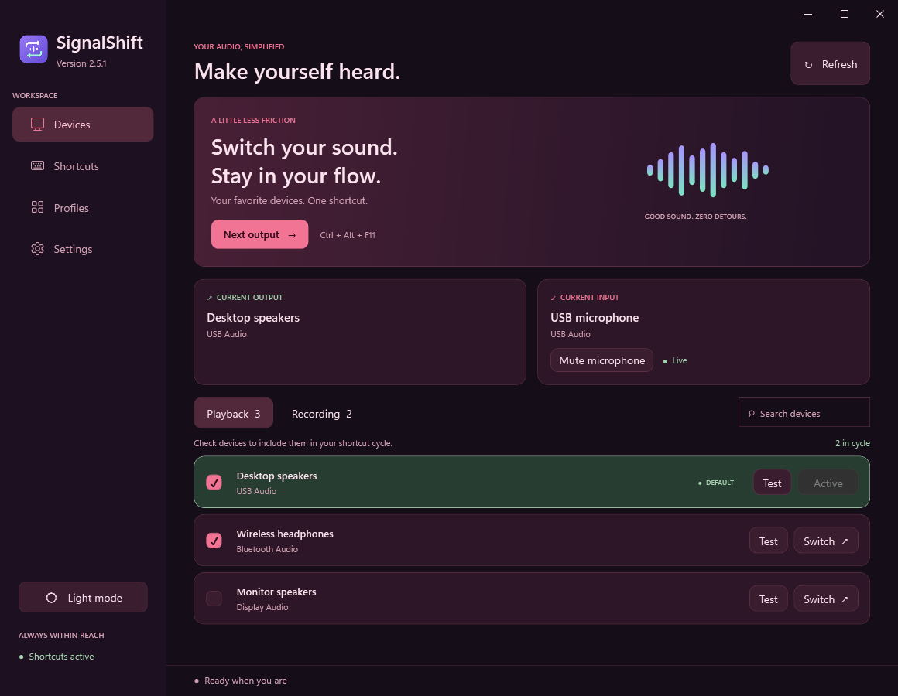
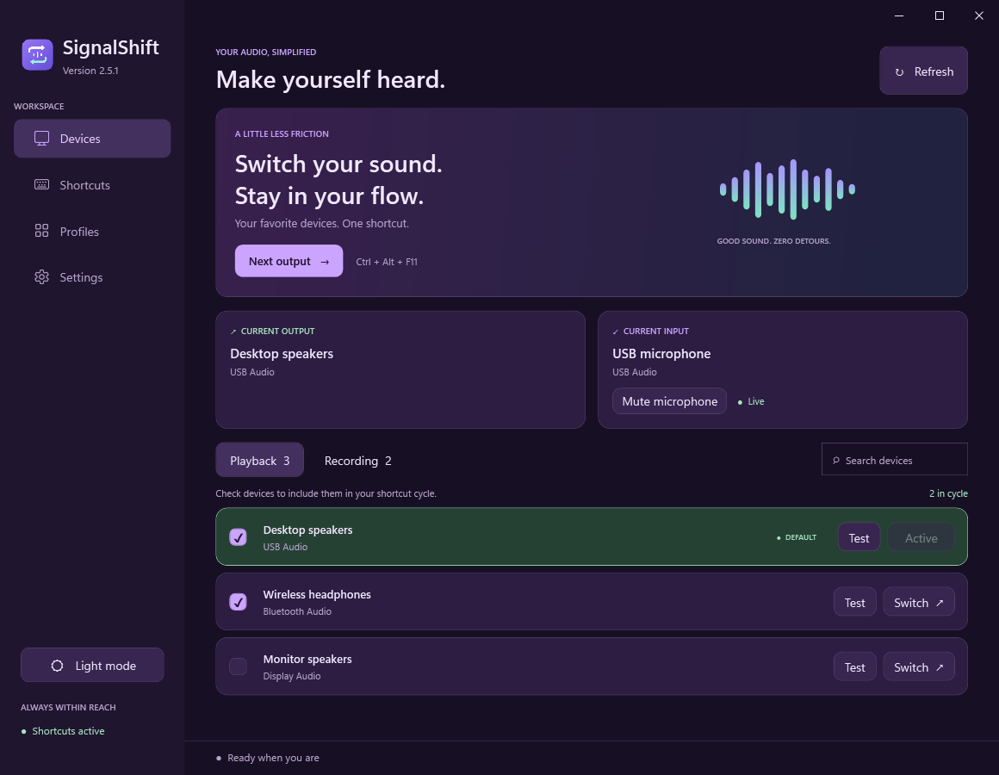
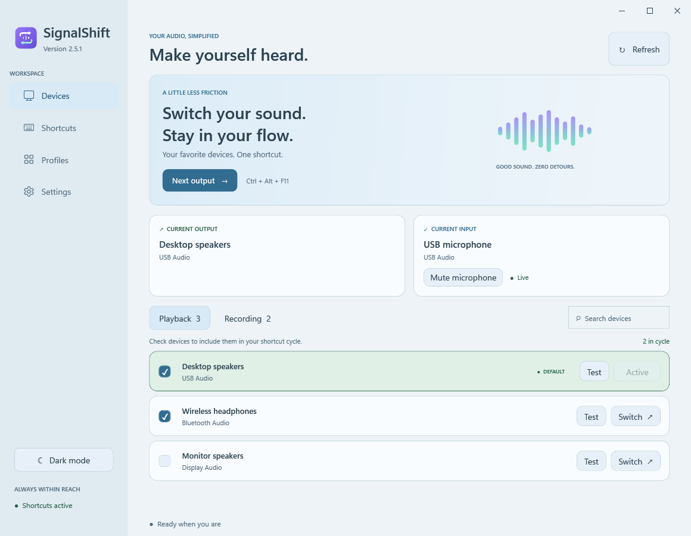
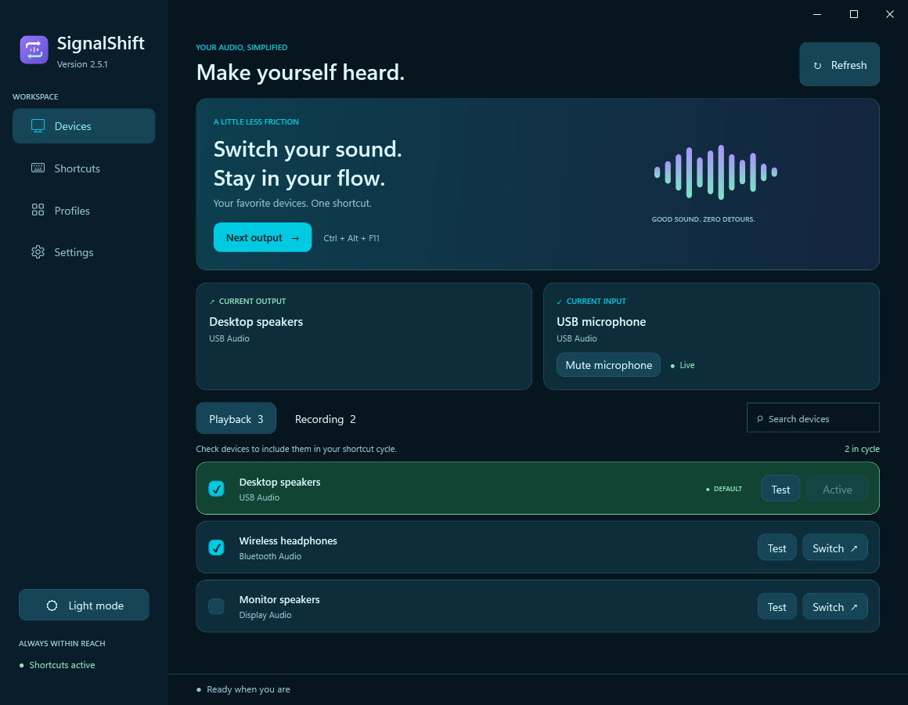
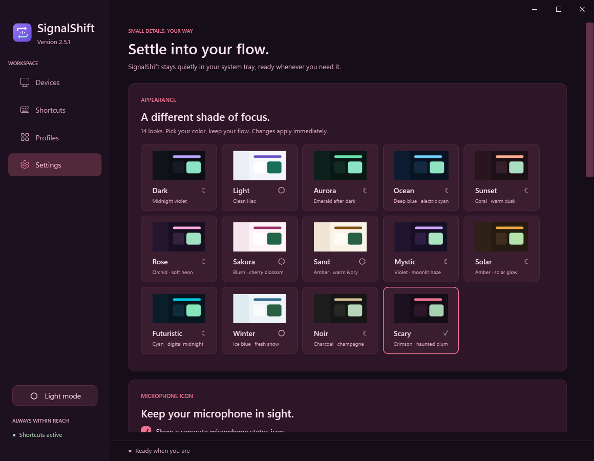

<p align="center"></p>
<h1 align="center">SignalShift</h1>
<p align="center">Your devices. Your shortcuts. Your flow.</p>
<p align="center">A native Windows audio switcher with profiles, microphone control and 14 color themes.</p>
<p align="center">
  <a href="https://github.com/youval1234/SignalShift/releases/latest"><strong>Download for Windows x64</strong></a>
  &nbsp; · &nbsp; <a href="#get-started">Get started</a>
  &nbsp; · &nbsp; <a href="#find-your-color">Explore themes</a>
  &nbsp; · &nbsp; <a href="docs/release-2.5.2.md">What's new</a>
</p>
<p align="center"><a href="https://github.com/youval1234/SignalShift/actions/workflows/build.yml"></a> · <a href="LICENSE">MIT license</a></p>



**One portable EXE. No separate .NET installation.** Releases are currently unsigned;
read the [Windows trust guide and responsibility notice](docs/windows-trust.md) before running a blocked download.

## Your everyday audio, one shortcut away

| What you want to do | How SignalShift helps |
| --- | --- |
| Jump between speakers and headphones | Choose devices for your playback shortcut cycle; disconnected choices are remembered and skipped. |
| Switch your whole setup | Activate an output/microphone profile, cycle profiles, or assign a profile shortcut. The current match is highlighted. |
| Know whether you're muted | A separate microphone tray icon follows Windows' state: green for live, red with a slash for muted, amber for mixed states. |
| Test a device before using it | Play a soft output tone or record a five-second microphone clip and hear it through your chosen output. |
| Make it feel like your desktop | Pick one of 14 themes in **Settings → Appearance**. Controls, dialogs and confirmation popups follow your choice. |
| Keep your setup | Export readable Notepad `.txt` settings, import them again, or migrate supported SoundSwitch device-cycle settings. |

Switches use a reusable popup and optional soft confirmation sounds. Repeated presses replace the current feedback immediately.
Short hover and press animations respect Windows animation preferences.

## Find your color

Choose a preview card in **Settings → Appearance**. Your selection applies immediately and is saved across restarts and settings exports.
The sidebar light/dark button remains available.

| Mystic | Winter |
| --- | --- |
|  |  |
| **Futuristic** | **Scary** |
|  |  |

| Theme | Palette | Theme | Palette |
| --- | --- | --- | --- |
| Dark | Midnight violet | Light | Clean lilac |
| Aurora | Emerald after dark | Ocean | Deep blue and electric cyan |
| Sunset | Coral and warm dusk | Rose | Orchid and soft neon |
| Sakura | Blush and cherry blossom | Sand | Amber and warm ivory |
| **Mystic** | Violet and moonlit haze | **Solar** | Amber and solar glow |
| **Futuristic** | Cyan and digital midnight | **Winter** | Ice blue and fresh snow |
| **Noir** | Charcoal and champagne | **Scary** | Crimson and haunted plum |

<details>
<summary>See the Settings theme picker and more views</summary>



| Original dark | Original light |
| --- | --- |
|  |  |


</details>

Screenshots use sample devices and profiles.

## Get started

1. Download **SignalShift.exe** and **SHA256SUMS.txt** from [Releases](https://github.com/youval1234/SignalShift/releases/latest).
2. Keep the EXE in a permanent folder and launch it. If replacing an older copy manually, quit it from the tray menu first.
3. In **Devices**, check the outputs and inputs you want in your shortcut cycles.
4. Open **Shortcuts** to choose your keys, and **Profiles** to save complete output/microphone pairs.

Default output/input shortcuts are **Ctrl + Alt + F11** and **Ctrl + Alt + F10**.
Microphone mute and profile cycling can be enabled separately under Shortcuts; suggested combinations are **Ctrl + Alt + M** and **Ctrl + Alt + P**.

## Microphone controls you can see

SignalShift keeps its purple app icon and a **separate microphone status icon**.
Right-click either for audio controls, or double-click to open the app.

**Settings → Microphone icon** lets you show/hide that status icon and open Windows' taskbar visibility settings.
To keep it beside the clock, drag it out of the **^** hidden-icons menu; Windows saves that choice.
Windows controls promotion out of the hidden menu, so the app does not claim to force that placement automatically.
See the [microphone and startup guide](docs/microphone-status.md).

**Start microphone live at Windows sign-in** is an explicit opt-in. It unmutes once at sign-in and preserves later intentional mutes and ordinary app restarts.
Mute controls the distinct Windows default recording endpoints for audio and calls. Mixed states are muted first.
Speaker volume/mute, microphone gain and default-device choices are preserved. Apps pinned to a different microphone need their own controls.

The optional `SignalShift.exe --toggle-microphone` command uses the same local mute control and can start the tray quietly if needed.

## Updates and Windows trust

Use **Settings → Updates → Check for updates**, or enable automatic checks at launch.
Updates download from this repository, verify SHA-256 and executable metadata, then replace the EXE and restart in place.
Offline or failed checks leave the existing version available. Preferences are preserved.

The app supports Windows 10/11 x64. Downloads remain **unsigned**: a checksum verifies bytes, not publisher trust.
Windows policies may block an EXE or update. SignalShift never changes Windows protections.
Read the [Windows trust guide and responsibility notice](docs/windows-trust.md) and [code-signing policy](CODE_SIGNING.md).

## Local by default

- No account, advertising or telemetry.
- Update checks contact GitHub; device information, preferences and microphone audio are not uploaded.
- Microphone mute never records audio. Device-test recording happens only when requested, stays in memory and is discarded when the test closes.
- Settings stay in `%LOCALAPPDATA%\Sonora\settings.json` for upgrade compatibility. Text exports include device names/IDs and should be shared intentionally.
- Imports create a restorable backup. Existing Sonora/SonarShift settings remain supported.

[Privacy policy](PRIVACY.md)

## Built to stay out of the way

The tray host runs separately from the settings window. Audio changes use notifications;
feedback reuses one popup and bounded sound buffers. Theme brushes, colors and tray images are cached.
Themes add no background polling, remote images or runtime dependencies.

[Memory measurements](docs/performance-1.5.md) · [Switch allocation investigation](docs/performance-switching.md) ·
[Refresh measurements](docs/release-2.4.4.md)

These measurements are workload-specific, not guarantees for every machine or audio driver.

## Build and validation

Install the .NET 10 SDK on Windows:

```powershell
./build.ps1
./build.ps1 -Test
```

The default build uses file-backed assemblies to favor lower private memory.
`./build.ps1 -Compact` makes a smaller EXE at the cost of higher private RAM.

Checks cover preferences, migration/import/export, shortcuts, profiles, microphone control,
theme selection and contrast, bounded audio tests, IPC, update safeguards and repeated-switch resources.
CI renders every theme across the main app pages. Hardware-specific tests restore original device and mute/volume states.

Optional audio tests use [NAudio](https://github.com/naudio/NAudio), under the MIT license.
Notices are embedded in the EXE and available in Settings. SignalShift is [MIT licensed](LICENSE).
