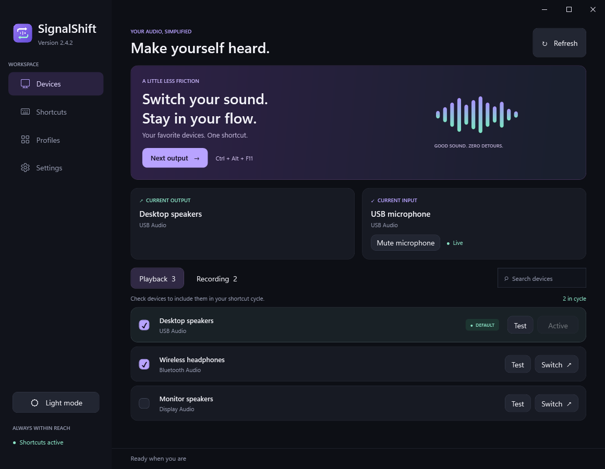
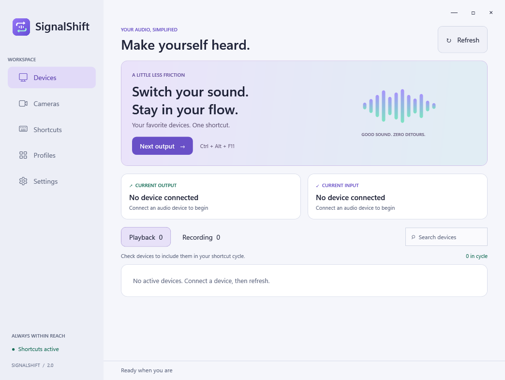

<p align="center"></p>
<h1 align="center">SignalShift</h1>
<p align="center">Your devices. Your shortcuts. Your flow.</p>

SignalShift is a native Windows audio switcher with global shortcuts, saved audio
profiles, dark/light themes and a lightweight background tray.

**[Download SignalShift 2.2.1 preview](https://github.com/youval1234/SignalShift/releases/tag/preview-2.2.1)**
for Windows x64. This self-contained EXE is unsigned; see the
[Windows trust guide and responsibility notice](docs/windows-trust.md).

| Dark | Light |
| --- | --- |
|  |  |

## New in 2.2

**2.2.1 fixes the “Specified cast is not valid” error in both device tests.**
The Core Audio watcher and test library now use independent COM wrappers. A
regression check keeps the watcher alive while opening the test enumerator.

- **Click to change appearance:** the sidebar light/dark button switches immediately
  and remembers your choice. Settings also offers Dark and Light buttons. The theme
  hotkey has been removed; older theme-shortcut preferences are ignored on import.
- **Test any output:** click **Test** beside a playback device, then **Play test sound**
  to hear a gentle chime through that exact endpoint without changing Windows defaults.
- **Hear your microphone:** click **Test** beside a recording device, choose a playback
  output, then **Record & hear (5 s)**. A live meter shows the input level; the clip
  plays after recording ends. Replay it or stop at any time. Recording starts only
  when requested, stays in a bounded memory buffer, and is discarded on close.
- **Lightweight tray preserved:** device-test audio libraries are used only by the
  settings process. The idle tray does not load them or capture microphone audio.

[Full release notes](docs/release-2.2.md).

## Audio profiles

- **One shortcut for all profiles:** enable **Cycle audio profiles** under Shortcuts.
  Its suggested shortcut is **Ctrl + Alt + P**, and you can record a different one.
  It applies the next profile's output and microphone together, skips disconnected
  setups, and wraps to the first profile. Profiles cycle in their displayed order.
- **More resilient settings reload:** brief file locks are retried while retaining
  the current settings, rather than crashing the background app.
- **Audio-only scope:** the experimental camera feature has been removed completely.
  There is no camera page, webcam hotkey, native camera DLL or camera installer in
  this version. If you installed the retired component, see the removal note below.

New shortcuts default to disabled when upgrading so they do not unexpectedly claim
keys. Existing individual profile shortcuts, audio choices and exports remain usable.
[Previous release notes](docs/release-2.1.md).

## Audio and profiles

Choose playback and recording devices to include in each cycle. Disconnected choices
are remembered and skipped until available again. Profiles apply an output and
microphone together; a device set to **Leave unchanged** keeps its current selection.
Use the profile-cycle shortcut or assign a dedicated shortcut to any profile.
When no profile is available, cycling makes no audio changes.

Default device shortcuts are **Ctrl + Alt + F11** for output and **Ctrl + Alt + F10**
for input. Configure them under Shortcuts. Conflicts are reported without silently
replacing another action. Console and multimedia roles are changed, with optional
communications switching for calls. Apps pinned to a specific device can retain it.

A soft confirmation pluck follows successful audio hotkeys. The reusable popup shows
the latest device or profile immediately, without notification queues or stealing
focus. Sounds and notifications can be enabled independently. Closing Settings
releases its process; the tray keeps handling shortcuts. Choose Quit to exit.

## Downloads and Windows trust

Download **SignalShift.exe** and **SHA256SUMS.txt** from the
[2.2.1 preview release](https://github.com/youval1234/SignalShift/releases/tag/preview-2.2.1).
Quit older Sonora/SonarShift/SignalShift processes before replacing the EXE.
Audio switching and themes support Windows 10/11 x64.

GitHub previews are unsigned. Smart App Control may block them; GitHub hosting or a
matching checksum does not establish a trusted publisher. The
[trust guide](docs/windows-trust.md) explains optional Windows settings and their
risks. The app never changes Windows security protections. See [signing status](CODE_SIGNING.md).

Distribution is through GitHub Releases.

### Removing the retired camera component

If you installed the optional 2.0 component, close apps using SignalShift Camera and
run the original **SignalShift.CameraSetup.exe --uninstall** with administrator
approval, then remove its extracted files. That installer belongs to the retired
2.0 component and is not shipped with current releases. Select your normal webcam again in apps
that used the virtual device. Your physical webcams and phone-camera software are
separate and do not need removal.

## Settings and privacy

Preferences remain in `%LOCALAPPDATA%\Sonora\settings.json` to preserve upgrades.
Settings → Export writes a UTF-8 Notepad `.txt` backup. Import accepts SignalShift,
SonarShift and Sonora exports, raw settings and SoundSwitch configurations; a
restorable backup is made before replacement. Retired camera fields are ignored
when importing old settings and are not exported by current versions.

Exports contain audio-device names and IDs, so share them intentionally. The app
has no account, telemetry, advertising or network service. Microphone testing is
local and temporary: no recording is saved to disk or uploaded.
Startup is opt-in. [Privacy policy](PRIVACY.md).

## Build and validation

Install the .NET 10 SDK on Windows, then run:

```powershell
./build.ps1
./build.ps1 -Test
```

The default portable build favors lower private memory. `./build.ps1 -Compact`
makes a smaller EXE at the cost of higher private RAM. No native camera build tools
or camera packages are required.

Checks cover settings migration/import/export, profile-cycle planning and shortcut
conflicts, the sidebar theme button and page rendering, retired theme-hotkey handling, locked
settings recovery, IPC collision handling, and repeated synthetic switch resource
use, plus bounded test recordings, clip erasure, cancellation before opening devices
and test-tone amplitude. These do not establish compatibility with every Windows audio driver.

The separate settings process, event-driven device refresh, reusable popup/tray,
bounded sound buffers and file-backed assemblies retain previous optimizations.
[Memory measurements](docs/performance-1.5.md) and
[switch allocation results](docs/performance-switching.md) remain historical
benchmarks, not new measurements of every workload. Optional audio tests use
[NAudio](https://github.com/naudio/NAudio) under the MIT license; notices are included
in the EXE and available under Settings → Third-party licenses.
