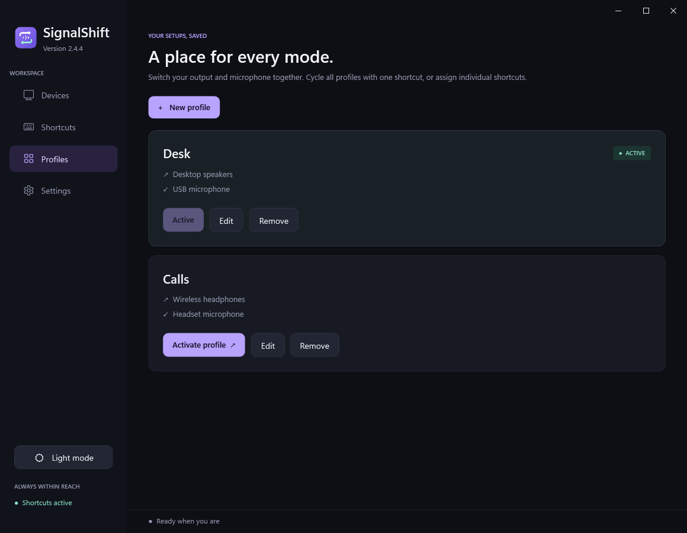

<p align="center"></p>
<h1 align="center">SignalShift</h1>
<p align="center">Your devices. Your shortcuts. Your flow.</p>

SignalShift is a portable Windows audio switcher with global shortcuts, saved audio
profiles, microphone mute, dark/light themes and a lightweight system tray.

**[Download the Windows x64 release](https://github.com/youval1234/SignalShift/releases/tag/v2.4.5)**.
The self-contained EXE needs no separate .NET runtime. Releases are currently unsigned;
see the [Windows trust guide](docs/windows-trust.md).

| Dark | Light |
| --- | --- |
|  |  |

Screenshots use sample devices and profiles.

## Features

- **Switch playback and recording devices:** choose the devices in each shortcut
  cycle. Disconnected choices are remembered and skipped until available.
- **Complete audio profiles:** switch output and microphone together. Cycle saved
  profiles or give each one a dedicated shortcut. The matching active profile is highlighted.
- **Microphone mute:** use the app button, tray menu or a configurable shortcut.
  The suggested combination is **Ctrl + Alt + M**, enabled under Shortcuts.
  The app reads the real Windows mute state and follows external changes.
  A green/red microphone tray icon shows live/muted state. [Startup unmute](docs/microphone-status.md) is an explicit sign-in option.
- **Clear feedback:** a reusable popup shows the latest action immediately, with
  optional confirmation sounds. Microphone feedback says **Microphone muted** or
  **Microphone live**.
- **Device tests:** play a sample through a chosen output, or record five seconds
  and hear your microphone through a chosen playback device. Clips remain in memory
  and are discarded when the test closes.
- **Automatic updates:** launch checks download newer releases from this repository, verify SHA-256 and executable metadata, then replace the portable EXE and restart. Settings includes an opt-out and a manual check. Updates follow published regular releases.
- **Responsive interface:** short hover, press and page transitions respect Windows animation preferences.
- **Light and dark themes:** switch with the sidebar button or choose in Settings.
- **Readable backups:** import/export Notepad `.txt` settings and migrate supported
  SoundSwitch device-cycle settings.

Default output/input shortcuts are **Ctrl + Alt + F11** and **Ctrl + Alt + F10**.
Suggested profile cycling is **Ctrl + Alt + P**. Configure them under Shortcuts;
new shortcut actions start disabled on general upgrades to avoid claiming keys.

Mute controls the distinct Windows default recording endpoints for console,
multimedia and calls. Mixed mute states are muted first. Speaker volume, speaker
mute, microphone gain and default-device choices are preserved. Apps pinned to a
separate microphone still need their own controls.

An optional `SignalShift.exe --toggle-microphone` command uses the same local mute
control and starts the tray quietly if needed. It works independently of the
keyboard-shortcut switch.



## Install and update

Download **SignalShift.exe** and **SHA256SUMS.txt** from the
[release page](https://github.com/youval1234/SignalShift/releases/tag/v2.4.5).
Quit the previous instance from its tray menu before replacing the EXE. Keep it in
a permanent location if you enable startup. Existing preferences are preserved.
From 2.4 onward, automatic launch checks can install newer verified downloads and
restart in place. Disable this in Settings if you prefer manual replacement. Offline
or failed checks leave the running version in place. Downloads remain unsigned;
Windows security policies may prevent an update.

The app supports Windows 10/11 x64. A checksum verifies the downloaded bytes; it
does not establish a trusted publisher. The app never changes Windows protections.
Read the [trust guide and responsibility notice](docs/windows-trust.md) and
[code-signing policy](CODE_SIGNING.md).

## Settings and privacy

Preferences remain in `%LOCALAPPDATA%\Sonora\settings.json` for upgrade compatibility.
Exports contain audio device names and IDs; share them intentionally. Imports make
a restorable backup before replacing preferences. Older Sonora/SonarShift settings
remain supported; retired fields are ignored.

SignalShift has no account, advertising or telemetry. Update checks contact GitHub;
no preferences, device information or audio are sent. Audio tests
are local and temporary. Microphone mute does not record audio. Startup is opt-in.
[Privacy policy](PRIVACY.md).

## Build and validation

Install the .NET 10 SDK on Windows, then run:

```powershell
./build.ps1
./build.ps1 -Test
```

The default build favors lower private memory with file-backed assemblies.
`./build.ps1 -Compact` produces a smaller EXE at the cost of higher private RAM.
The settings window runs separately from the tray, device changes use notifications,
and feedback reuses bounded sound buffers and one popup.

Checks cover settings migration/import/export, shortcut conflicts, device/profile
cycling, mute command handling, theme controls, bounded test clips, notification
reuse, settings lock recovery and IPC. Hardware-specific tests restore original
states. Automated checks do not establish compatibility with every audio driver.

[Release notes](docs/release-2.4.4.md) · [Memory measurements](docs/performance-1.5.md) ·
[Switch allocation results](docs/performance-switching.md).
Historical measurements are workload-specific, not guarantees for every machine.

Optional audio tests use [NAudio](https://github.com/naudio/NAudio) under the MIT
license. Notices are embedded in the EXE and available in Settings.
